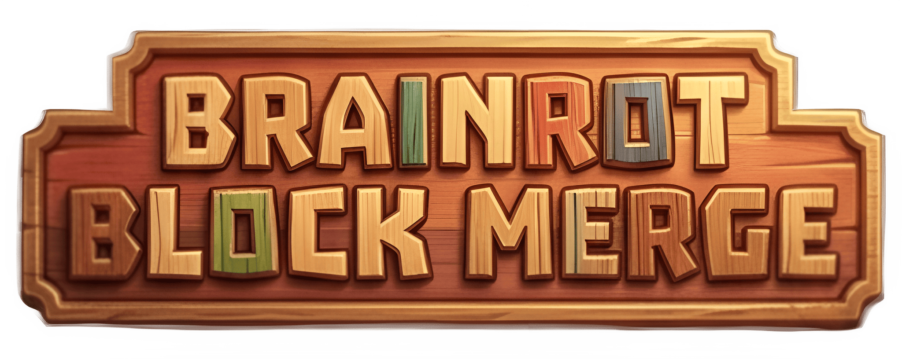
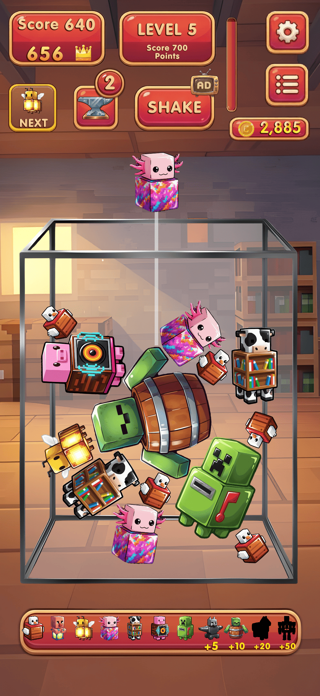
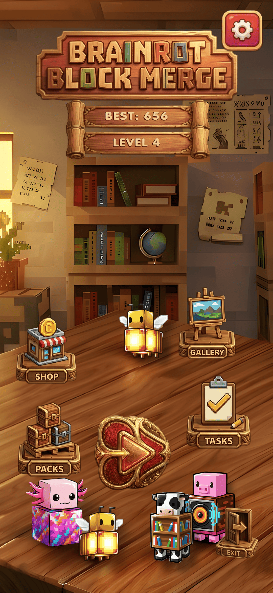
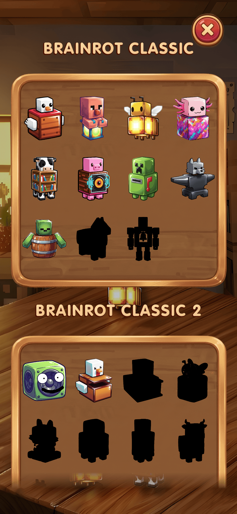
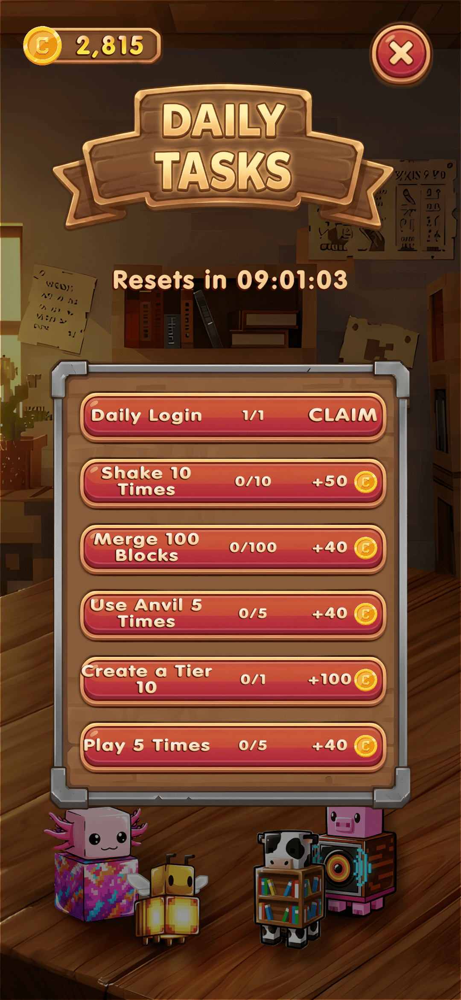
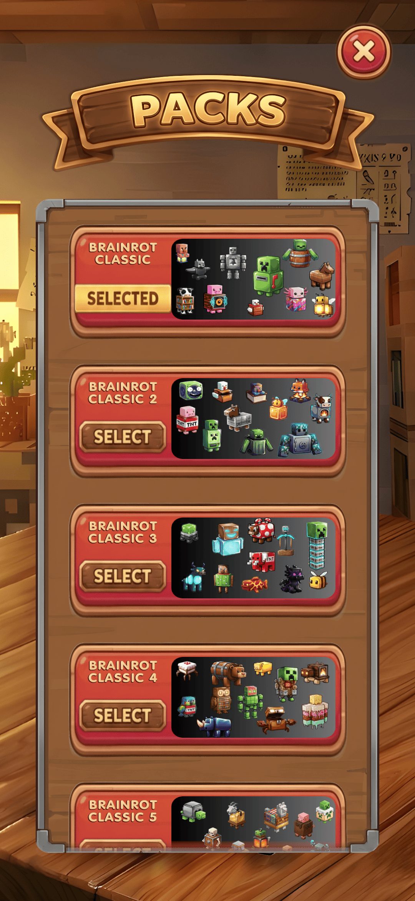
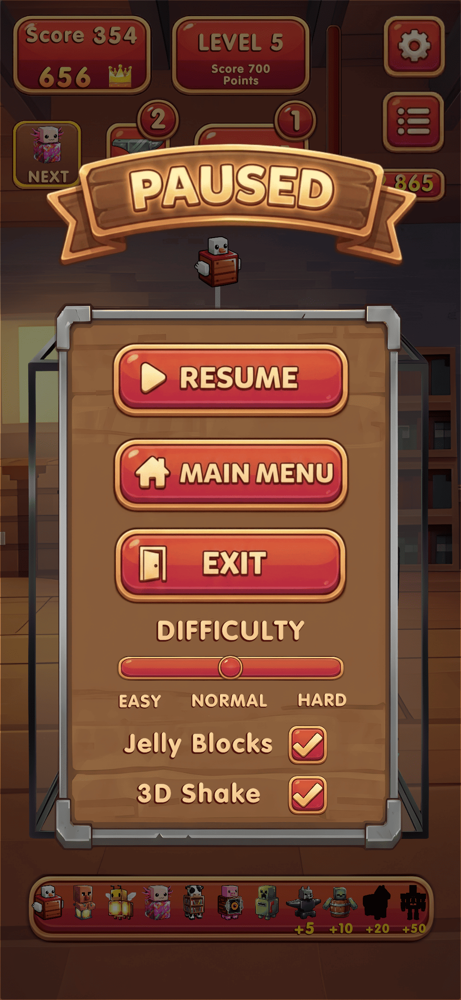

[](https://www.gnu.org/licenses/gpl-3.0)

```Brainrot Block Merge``` is a cool game that I made using Unity. It is a puzzle game that has a lot of physics in it. You can drop blocks bounce them around and merge them to get to the levels. It is now available on the Google Play Store.

---

## Core Features

* **Infinite Gameplay Loop:** You can play forever because the game makes goals for you all the time. These goals get harder and harder as you play.

* **Addictive Game Feel:** I made sound effects for it and the particles that explode when you beat a level are really satisfying.
* **Strategic Power-Ups:** 
  * **Shake:** Uses the phones gyroscope to mix up the blocks on the screen.
  * **Anvil:**  A heavy block that can crush other blocks to clear space.
* **Ultimate Customization:** A massive in-game shop where players can unlock dynamic 3D-illusion buckets, backgrounds, laser guides.
* **Dynamic Audio Engine:** Unlockable voice effects that apply real-time DSP filters (Echo, Distortion, High-Pass, Dynamic Pitch Shifting) to the brainrot audio.
* **Evolution Gallery:** A gallery where you can see all the characters you have unlocked. Can interact with the characters in the gallery, Hear their sounds. (Soundboard)
* **Daily Missions & Economy:** The game also has missions that you can complete to get rewards. These missions are different every day. They are tied to a system that tracks your progress in the game.
* **Player Accessibility:** Pause Menu, Real-time adjustments to game difficulty (Easy/Normal/Hard), Jelly Physics toggling, and Battery Saver (FPS/vSync) modes.
* **Monetization & Backend:** Integrated with Google AdMob for rewarded power-ups, a premium VIP Pass for ad-free play, and Google Play Games Services for automatic Cloud Saves and Achievements.–-

---


## ScreenShots



## Project Architecture

The codebase is strictly organized following industry-standard Unity project structures to ensure scalability and clean dependency management:

```
Assets/
├── _Game/
│   ├── Audio/
│   │   ├── Music/          # Background music tracks
│   │   └── SFX/            # UI sound effects
│   ├── Fonts/              # TextMeshPro fonts and typography assets
│   ├── Physics/            # Physics Materials
│   ├── Prefabs/            # Fellas, Boss blocks, Anvils, and Particle Systems
│   ├── Scenes/             
│   ├── Scripts/
│   │   ├── Core/
│   │   ├── Gameplay/
│   │   ├── Monetization/
│   │   ├── UI/
│   │   └── Utilities/
│   ├── Settings/
│   ├── Sprites/
│   │   ├── Gameplay/       # Lasers, and Bucket illusions
│   │   └── UI/             # Buttons, Panels, and Icons
│   └── ThemePacks/         # Modular visual/audio character pack data
├── Adaptive Performance/   # Unity thermal and performance management
├── GoogleMobileAds/        # Third-party SDKs
└── GooglePlayGames/        # Third-party SDKs
```

## Release Milestones

* **v1.2.0 - Cloud Save:** Scores, Coins, Unlocks and Levels are automatically saved to Google account.
Infinite Levels: The game never ends! Level up with dynamic goals (Score sand Collections). **10+ Google Play Achievements**.
* **v1.1.0 - Monetization & Bug Fixes.** 
* **v1.0.0 - Core Launch:** Initial Google Play Release.

---
              
## Building and Running

Built with Unity ```6000.3.5f2```
To run the project, Clone this repository and open it in Unity (available from [https://unity.com/download](https://unity.com/download)).

*(Note that some things like the Google Play Keystores and AdMob Unit IDs have been removed from the repository for security reasons.. You can still play the game, in the Unity Editor.)*
---

## Contributing

If you want to help me with the game you can open an issue. Submit a pull request. You can also reach out to me directly on LinkedIn.[Connect with me on LinkedIn](https://www.linkedin.com/in/methuka-pasandul-38a4a832b/)

## License
This project is open-source and released under the [GPL-3.0 license](LICENSE).


## Downloads
<a href="https://play.google.com/store/apps/details?id=com.orizozointeractive.brainrotblockmerge&pcampaignid=web_share">
  
</a>
